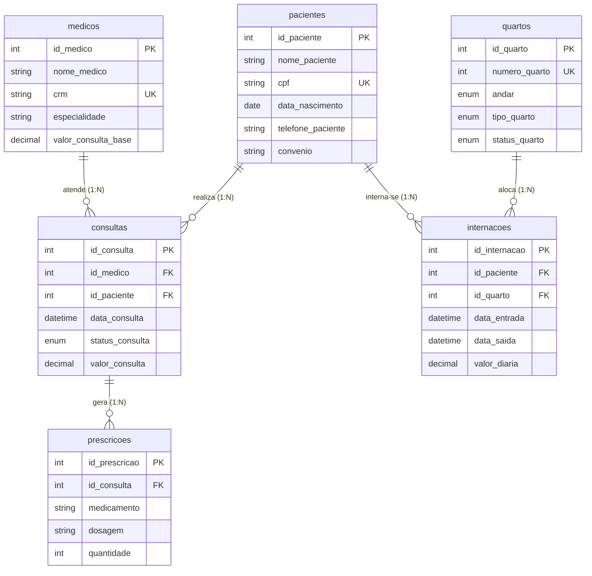

# db_hospital
SGBD gerenciamento de um hospital. Atividade para fins avaliativos.

[documenta_o_do_banco_de_dados_hospitalar (2).md](https://github.com/user-attachments/files/34375866/documenta_o_do_banco_de_dados_hospitalar.2.md)
# 🏥 Sistema de Gestão Hospitalar — Documentação do Banco de Dados

## 1. Contextualização do Projeto

A consultoria de TI assumiu a infraestrutura digital do **Hospital Geral Vida & Saúde**. Anteriormente, a instituição operava de forma legada utilizando planilhas eletrônicas isoladas e registros físicos em papel. Esta ausência de um SGBD relacional provocou graves colapsos operacionais no último trimestre:

* **Inconsistência Financeira:** 15% dos atendimentos geraram cobranças incorretas.
* **Perda de Histórico:** Perda de 8% do histórico clínico de pacientes crônicos.
* **Conflito de Agendas:** Sobreposição de horários médicos resultou no cancelamento de 45 consultas na última semana.

Este projeto apresenta a solução de Banco de Dados Relacional desenvolvida em **MySQL 8.0** para ambiente de homologação.

---

## 2. Proposta de Solução & Regras de Negócio

A modelagem lógica foi estruturada de forma normalizada (**até a 3ª Forma Normal**), implementando:

1. **Prevenção de Overbooking Médico:** Constraint `UNIQUE (id_medico, data_consulta)` na tabela `consultas`.
2. **Prevenção de Sobreposição de Leitos:** Constraint `UNIQUE (id_quarto, data_entrada)` na tabela `internacoes`.
3. **Integridade Referencial Estrita:** Uso de `ON DELETE RESTRICT` nas Foreign Keys ligadas a pacientes e médicos para evitar exclusão acidental de histórico clínico.
4. **Consistência de Dados de Farmácia:** Restrição `CHECK` na tabela `prescricoes` garantindo a obrigatoriedade conjunta de medicamento, dosagem e quantidade.†

---

## 3. Estrutura dos Arquivos SQL (DDL/DML)

O banco de dados `db_hospital` é composto por 6 scripts organizados que contêm a estrutura e a carga de dados (com no mínimo 10 registros por tabela):

```text
db_hospital /
├── db_hospital_pacientes.sql     # Cadastro de pacientes (10 registros)
├── db_hospital_medicos.sql       # Corpo médico e especialidades (10 registros)
├── db_hospital_quartos.sql       # Cadastro de leitos e andares (10 registros)
├── db_hospital_consultas.sql     # Registros de consultas (10 registros)
├── db_hospital_prescricoes.sql   # Receituário médico (10 registros)
└── db_hospital_internacoes.sql   # Histórico de internações (10 registros)
```

---

## 4. Glossário Técnico: Diferença entre CHAR e VARCHAR

No projeto `db_hospital`, foram utilizados dois tipos principais de cadeias de caracteres de acordo com a natureza dos dados:

* **`CHAR(n)` (Tamanho Fixo):**
  * Aloca sempre uma quantidade fixa de memória no disco definida no parâmetro $n$, independente da quantidade de caracteres digitados (preenchendo o restante com espaços em branco).
  * **Uso no Projeto:** Utilizado no campo `crm` (`varchar(20)`) e `cpf` (`varchar(14)`), onde o formato segue um número fixo de caracteres padrão. A vantagem é o desempenho ligeiramente mais rápido em indexação e leitura.

* **`VARCHAR(n)` (Tamanho Variável):**
  * Aloca dinamicamente apenas o espaço utilizado pelos caracteres reais inseridos mais 1 ou 2 bytes de prefixo de tamanho.
  * **Uso no Projeto:** Utilizado em `nome_paciente varchar(200)`, `especialidade varchar(200)`, `medicamento varchar(200)` e `convenio varchar(200)`. A vantagem é a economia considerável de espaço em disco quando a extensão dos textos é imprevisível.

---

## 5. Modelagem Lógica do Banco de Dados

### Diagrama Entidade-Relacionamento (Mermaid.js)



---

## 6. Aplicação das Formas Normais (1FN, 2FN e 3FN)

* **1ª Forma Normal (1FN):** Atributos atômicos. Prescrições medicamentosas foram isoladas na tabela `prescricoes` em vez de listas concatenadas na tabela `consultas`.
* **2ª Forma Normal (2FN):** Eliminação de dependências parciais. Todos os atributos não-chave de `prescricoes`, `consultas` e `internacoes` dependem integralmente das suas respectivas chaves primárias simples.
* **3ª Forma Normal (3FN):** Eliminação de dependências transitivas. A tabela `internacoes` referencia apenas `id_quarto`, evitando armazenar atributos transitivos como `andar` ou `tipo_quarto`, que pertencem exclusivamente a `quartos`.

---

## 7. Instruções de Instalação e Criação do Banco

```sql
CREATE DATABASE IF NOT EXISTS db_hospital


USE db_hospital;
```

### Ordem Sequencial de Execução de Scripts:

1. `db_hospital_pacientes.sql`
2. `db_hospital_medicos.sql`
3. `db_hospital_quartos.sql`
4. `db_hospital_consultas.sql`
5. `db_hospital_prescricoes.sql`
6. `db_hospital_internacoes.sql`

---

## 8. Relatório de Queries Estratégicas (DQL — 15 Perguntas de Negócio)

### Pergunta 1 (Farmácia)
**Demanda:** Emitir um relatório completo contendo o nome do paciente, nome do médico atendedor, data da consulta, medicamento prescrito e a quantidade receitada.†

```sql
SELECT 
    p.nome_paciente,
    m.nome_medico,
    c.data_consulta,
    pr.medicamento,
    pr.quantidade
FROM prescricoes pr
INNER JOIN consultas c ON pr.id_consulta = c.id_consulta
INNER JOIN pacientes p ON c.id_paciente = p.id_paciente
INNER JOIN medicos m ON c.id_medico = m.id_medico
ORDER BY c.data_consulta DESC;
```

### Pergunta 2 (Auditoria)
**Demanda:** Histórico de internações com o nome do paciente, o número do quarto, o andar onde ele está localizado, a data de entrada na internação e o valor da diária.

```sql
SELECT 
    p.nome_paciente,
    q.numero_quarto,
    q.andar,
    i.data_entrada,
    i.valor_diaria
FROM internacoes i
INNER JOIN pacientes p ON i.id_paciente = p.id_paciente
INNER JOIN quartos q ON i.id_quarto = q.id_quarto
ORDER BY i.data_entrada DESC;
```

### Pergunta 3 (Recepção)
**Demanda:** Listar o nome de todos os pacientes, seus respectivos convênios, os nomes dos médicos que os atenderam e suas especialidades.

```sql
SELECT 
    p.nome_paciente,
    p.convenio,
    m.nome_medico,
    m.especialidade
FROM consultas c
INNER JOIN pacientes p ON c.id_paciente = p.id_paciente
INNER JOIN medicos m ON c.id_medico = m.id_medico
ORDER BY p.nome_paciente;
```

### Pergunta 4 (Coordenação Médica)
**Demanda:** Lista de todas as prescrições emitidas, indicando o nome do médico responsável, a sua especialidade, o nome do paciente atendido e o remédio indicado.

```sql
SELECT 
    m.nome_medico,
    m.especialidade,
    p.nome_paciente,
    pr.medicamento
FROM prescricoes pr
INNER JOIN consultas c ON pr.id_consulta = c.id_consulta
INNER JOIN medicos m ON c.id_medico = m.id_medico
INNER JOIN pacientes p ON c.id_paciente = p.id_paciente
ORDER BY m.nome_medico;
```

### Pergunta 5 (Diretoria Médica)
**Demanda:** Cruzar dados dos pacientes que já foram internados e também passaram por consultas: exiba sem duplicidades o nome do paciente, o quarto ocupado na internação, o nome do médico atendente na consulta e a data dessa consulta.

```sql
SELECT DISTINCT
    p.nome_paciente,
    q.numero_quarto,
    m.nome_medico,
    c.data_consulta
FROM pacientes p
INNER JOIN internacoes i ON p.id_paciente = i.id_paciente
INNER JOIN quartos q ON i.id_quarto = q.id_quarto
INNER JOIN consultas c ON p.id_paciente = c.id_paciente
INNER JOIN medicos m ON c.id_medico = m.id_medico
ORDER BY p.nome_paciente, c.data_consulta;
```

### Pergunta 6 (Atendimentos Recentes)
**Demanda:** Liste o nome dos pacientes, o nome do médico e a data da consulta para todas as consultas registradas, exibindo primeiro os atendimentos mais recentes.

```sql
SELECT 
    p.nome_paciente,
    m.nome_medico,
    c.data_consulta
FROM consultas c
INNER JOIN pacientes p ON c.id_paciente = p.id_paciente
INNER JOIN medicos m ON c.id_medico = m.id_medico
ORDER BY c.data_consulta DESC;
```

### Pergunta 7 (Setor Financeiro - Diárias)
**Demanda:** Listagem com o nome do paciente, o número do quarto e o valor da diária cobrado, ordenando do menor valor de diária para o maior.

```sql
SELECT 
    p.nome_paciente,
    q.numero_quarto,
    i.valor_diaria
FROM internacoes i
INNER JOIN pacientes p ON i.id_paciente = p.id_paciente
INNER JOIN quartos q ON i.id_quarto = q.id_quarto
ORDER BY i.valor_diaria ASC;
```

### Pergunta 8 (Média de Consultas)
**Demanda:** Qual é o valor médio praticado nas consultas médicas registradas até o momento no hospital?

```sql
SELECT 
    ROUND(AVG(valor_consulta), 2) AS valor_medio_consultas
FROM consultas;
```

### Pergunta 9 (Arrecadação Total de Consultas)
**Demanda:** Qual é o valor total já arrecadado pelo hospital exclusivamente com as consultas médicas agendadas/realizadas?

```sql
SELECT 
    SUM(valor_consulta) AS faturamento_total_consultas
FROM consultas;
```

### Pergunta 10 (Família Silva)
**Demanda:** Identifique as consultas realizadas por pacientes que possuem a família "Silva" no nome. Apresente o nome do paciente, nome do médico e a data da consulta.†

```sql
SELECT 
    p.nome_paciente,
    m.nome_medico,
    c.data_consulta
FROM consultas c
INNER JOIN pacientes p ON c.id_paciente = p.id_paciente
INNER JOIN medicos m ON c.id_medico = m.id_medico
WHERE p.nome_paciente LIKE '%Silva%'
ORDER BY c.data_consulta;
```

### Pergunta 11 (Área de Cardiologia)
**Demanda:** Busque todas as consultas conduzidas por médicos de alguma área ligada à Cardiologia (especialidade contendo "Cardio"), mostrando o nome do paciente, o nome do médico e a especialidade.

```sql
SELECT 
    p.nome_paciente,
    m.nome_medico,
    m.especialidade
FROM consultas c
INNER JOIN pacientes p ON c.id_paciente = p.id_paciente
INNER JOIN medicos m ON c.id_medico = m.id_medico
WHERE m.especialidade LIKE '%Cardio%'
ORDER BY m.nome_medico;
```

### Pergunta 12 (Internações 1º Semestre 2026)
**Demanda:** Levantamento de todas as internações com data de entrada ocorridas especificamente no primeiro semestre do ano de 2026 (entre 01/01/2026 e 30/06/2026). Retorne o nome do paciente, número do quarto e a data de entrada.

```sql
SELECT 
    p.nome_paciente,
    q.numero_quarto,
    i.data_entrada
FROM internacoes i
INNER JOIN pacientes p ON i.id_paciente = p.id_paciente
INNER JOIN quartos q ON i.id_quarto = q.id_quarto
WHERE i.data_entrada BETWEEN '2026-01-01 00:00:00' AND '2026-06-30 23:59:59'
ORDER BY i.data_entrada;
```

### Pergunta 13 (Receita por Convênio Unimed)
**Demanda:** Valor total investido em consultas por pacientes do plano "Unimed" (qualquer variação contendo Unimed). Agrupe o resultado por paciente, mostre o convênio e ordene a receita do maior valor gasto para o menor.

```sql
SELECT 
    p.nome_paciente,
    p.convenio,
    SUM(c.valor_consulta) AS total_investido
FROM consultas c
INNER JOIN pacientes p ON c.id_paciente = p.id_paciente
WHERE p.convenio LIKE '%Unimed%'
GROUP BY p.id_paciente, p.nome_paciente, p.convenio
ORDER BY total_investido DESC;
```

### Pergunta 14 (Custos de Internação - Sobrenome Oliveira)
**Demanda:** Mapear o custo total das diárias de internação agrupado por andar dos quartos, considerando apenas pacientes que tenham o sobrenome "Oliveira". Ordene o resultado pelo número do andar em ordem crescente.

```sql
SELECT 
    q.andar,
    SUM(i.valor_diaria) AS custo_total_diarias
FROM internacoes i
INNER JOIN pacientes p ON i.id_paciente = p.id_paciente
INNER JOIN quartos q ON i.id_quarto = q.id_quarto
WHERE p.nome_paciente LIKE '%Oliveira%'
GROUP BY q.andar
ORDER BY q.andar ASC;
```

### Pergunta 15 (Faturamento Departamento Cirúrgico)
**Demanda:** Faturamento total em consultas agrupado pelas especialidades médicas que pertençam ao departamento cirúrgico (especialidade contendo o termo "Cirurgia"). Apresente a especialidade, o total arrecadado e ordene do maior faturamento para o menor.

```sql
SELECT 
    m.especialidade,
    SUM(c.valor_consulta) AS faturamento_total
FROM consultas c
INNER JOIN medicos m ON c.id_medico = m.id_medico
WHERE m.especialidade LIKE '%Cirurgia%'
GROUP BY m.especialidade
ORDER BY faturamento_total DESC;
```

---

## 9. Procedimentos de Exportação e Importação (Dump)

### Via Terminal
```bash
# Exportar base completa
mysqldump -u root -p --databases db_hospital > dump_db_hospital.sql

# Importar em ambiente de homologação
mysql -u root -p < dump_db_hospital.sql
```

### Via MySQL Workbench
1. Acesse **Server** $\rightarrow$ **Data Export**.
2. Selecione a base `db_hospital` e escolha a opção **Dump Structure and Data**.
3. Exporte para um arquivo único `.sql`.†


## De Julia†Karol 
